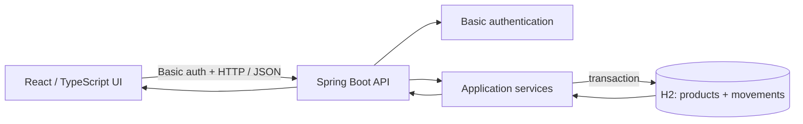

# Inventory Management System Architecture
**Stage 2 status:** Approved by the user on 2026-11-03.
## Overview
Proposed single-location web architecture: React/TypeScript UI calls a Spring Boot API; backend services coordinate product and stock operations over in-memory H2. Product, stock, history, alerts, and search map to US-01..05 (SCRUM-3/4/6/7/8).
## Project Technology Profile
Confirmed: full-stack web; Java/Spring Boot; React/TypeScript; in-memory H2; local deployment. Build/package and test tools are unspecified; no application source or manifests exist. Proposed boundaries below add no dependencies or infrastructure.
## Components
| Component | Responsibility | Interactions |
|---|---|---|
| React UI (proposed) | Login; responsive inventory/product/detail forms, stock actions/history, low-stock/search; deactivate products | Basic credentials in Authorization header only; INR formatting and WCAG 2.2 AA states |
| Spring Boot API (confirmed framework; proposed boundary) | INVENTORY_MANAGER Basic-authenticated /api/v1 operations; validation and Problem Details | UI -> services over loopback HTTP or network HTTPS |
| Application services (proposed) | Enforce SKU/stock invariants, optimistic locking, and deactivate without deleting history | Coordinate version check, balance update, and movement insert in one transaction |
| H2 persistence (confirmed) | Product active/version fields and retained movement records | Repositories read/write data; all data is lost on process restart (accepted) |
## API, Data, and Flow
Proposed `/api/v1` routes: `GET /auth/me`; `GET/POST /products`; `GET/PUT /products/{id}`; `PATCH /products/{id}/deactivation`; `POST /products/{id}/movements`; `GET /products/{id}/movements`; `GET /products/low-stock`; product query parameters `query`, `category`, `stockStatus`. Problem Details: 400 validation, 401 unauthenticated, 403 forbidden, 404 missing, 409 duplicate SKU/stale stock version.
Product: required name (1-120 Unicode code points), SKU (1-64 trimmed ASCII matching `[A-Z0-9][A-Z0-9._/-]{0,63}` after uppercase), category, INR price/minimum threshold; optional description (<=2,000 code points), rejecting controls except newline/tab. Category is a seeded lookup extensible by data rows. Start stock at zero. Price `DECIMAL(14,2)`; countable integer stock `DECIMAL(12,0)` up to 999,999,999,999; reject invalid precision/range, never round. Movement: ID, product ID, IN/OUT, positive integer quantity, required reason/reference, authenticated username, server-generated UTC timestamp; display in user-local time. Deactivation is terminal and preserves ID/history; inactive products are omitted from normal lists and cannot receive stock. H2 restart loss is accepted.
Flow: env-provisioned INVENTORY_MANAGER credentials authenticate every API request -> validate -> stock service compares expected/current version -> transaction updates balance/version and inserts movement -> UI refreshes. Stale versions return 409 without a movement; failures roll back both writes. Low stock is quantity <= threshold, including zero.

## Decisions and Quality
Confirmed: Basic authentication, optimistic locking, soft deletion with history retention, INR unit pricing at two fractional digits with rejection (no rounding) above scale 2, and acceptance of in-memory H2 restart data loss. Proposed: credential handling in the UI, version field/expected-version contract, active flag, and UI/API/service/repository boundaries. No new dependency or tooling selected.
Security/validation: all API routes require Basic auth and INVENTORY_MANAGER; credentials come from environment variables, with no defaults, persistence or logging. Use loopback-only HTTP locally and HTTPS if network-bound. Validate at UI/API/service boundaries; enforce normalized SKU uniqueness at DB and numeric constraints; return safe Problem Details.
Integrity/testing: stale stockVersion must reject the operation without recording a movement; successful balance/version update and movement insert commit atomically. Deactivation preserves product IDs and all history; normal inventory/low-stock views exclude inactive products while history remains addressable. Test conflicts, rollback, retained history, and soft deletion.
Risks/constraints: H2 restart loss is accepted and documented; it precludes durable inventory history. Inactive product reactivation is not supported; stock operations on inactive products are rejected. No source/manifests constrain further compatibility decisions.
## Open Decisions
Reproducible p95 benchmark environment/request mix and exact dependency/tool approval. Category, field and integer-stock recommendations are user-approved. No dependencies are installed.