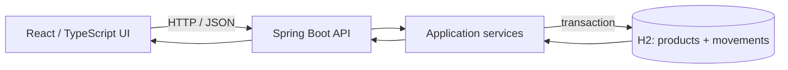

# Inventory Management System Architecture
## Overview
Proposed single-location web architecture: React/TypeScript UI calls a Spring Boot API; backend services coordinate product and stock operations over in-memory H2. Product, stock, history, alerts, and search map to US-01..05 (SCRUM-3/4/6/7/8).
## Project Technology Profile
Confirmed: full-stack web; Java/Spring Boot; React/TypeScript; in-memory H2; local deployment. Build/package and test tools are unspecified; no application source or manifests exist. Proposed boundaries below add no dependencies or infrastructure.
## Components
| Component | Responsibility | Interactions |
|---|---|---|
| React UI (proposed) | Responsive product list/details/forms, stock actions, movement history, low-stock view, combined search/filters | Calls API; renders validation, empty, and operation-error states |
| Spring Boot API (confirmed framework; proposed boundary) | Product, stock, history, and search/low-stock operations; request validation and error mapping | UI -> services; exposes HTTP/JSON |
| Application services (proposed) | Enforce unique SKU, positive movement quantity, nonnegative balance, and stock <= threshold rule | Coordinate repositories in one stock-change transaction |
| H2 persistence (confirmed) | Runtime product and movement records | Repositories read/write data; data is lost on process restart |
## API, Data, and Flow
Proposed resource surface: product list/detail/create/update/delete; stock IN/OUT operation; per-product movement history; product query by name/SKU, category, and stock status. Exact routes and payload fields remain implementation choices.
Proposed records: Product (id, required product attributes, SKU, balance, threshold) and StockMovement (id, product ID, IN/OUT, positive quantity, reason/reference, timestamp). Money representation, actor, and timestamp/time-zone policy remain open.
Flow: UI submits validated operation -> API/service checks business invariants -> database transaction updates balance and inserts movement -> response refreshes product status/history. A failure rolls back both writes; low stock is computed as balance <= threshold, including zero.

## Decisions and Quality
Confirmed choices: stack, local deployment, single location, and H2. Proposed choices: UI/API/service/repository boundaries; product and movement records; transactional stock/history writes; computed low-stock status. No build, test, or runtime dependency is selected.
Security/validation: validate inputs and invariants at the API/service boundary; enforce SKU uniqueness and nonnegative balance in persistence where supported; return actionable errors without exposing internals. Authentication/authorization and detailed field rules are unresolved; local deployment does not establish a security policy.
Testing: automated tests are required; framework and build tool are open. Cover product validation/uniqueness, stock IN/OUT and rollback, chronological history, threshold boundaries, search/filter combinations, and errors. Verify UI responsive behavior when implementation exists.
Risks/constraints: H2 is ephemeral across restarts; it cannot provide durable inventory history. Transaction atomicity is required, but concurrent update/locking strategy is not selected. No source/manifests constrain further compatibility decisions.
## Open Decisions
Deletion when movements exist; currency/price precision; authentication and authorization; detailed required-field, SKU normalization, category, and initial-stock rules; concurrency strategy; movement reason/actor/timestamp/time-zone policy; measurable quality, accessibility, and UI targets; build/package and test tools.